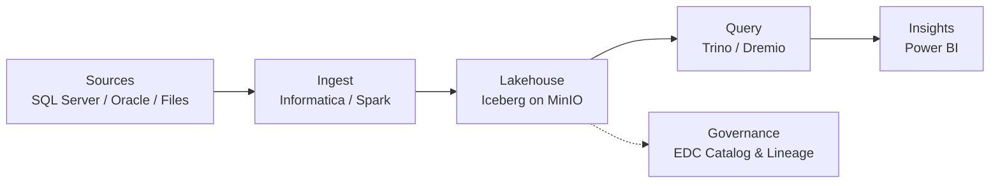

<!-- 
  HOW TO USE:
  1. Create a PUBLIC repo named exactly like your GitHub username (e.g. github.com/alisherif98/alisherif98)
  2. Paste this file as README.md
  3. Replace YOUR_EMAIL, YOUR_LINKEDIN with your own values
-->

  

<h1 align="center">&#x1F44B; Hi, I'm Ali Sherif &#x2615;&#x1F5C4;&#xFE0F;&#x2699;&#xFE0F;&#x1F4CA;&#x1F30A;</h1>
<h3 align="center">Data Engineer &#xB7; ETL Architect &#xB7; Lakehouse Builder &#xB7; Data Governance Enthusiast</h3>

  

---

### &#x2615; About Me

- &#x2615; Firm believer that coffee reduces pipeline latency and increases throughput (unbenchmarked, but trusted).
- &#x1F6E0;&#xFE0F; Builds **ETL/ELT pipelines** that run at 3 AM so nobody else has to be awake.
- &#x1F50D; Chases **incomplete lineage** in data catalogs like a detective chasing a missing suspect.
- &#x1F30A; Spends free time spinning up **Docker lakehouses** &#x2014; and then debugging why MinIO won't start.
- &#x1F9EA; Background in **computational chemistry** &#x2014; so yes, I've converged both SCF cycles and DTM buffers.

---

### &#x1F9ED; My Philosophy of Data Life

> *"Garbage in, garbage out."* &#x2014; every data engineer, ever.
>
> And the greatest joy is a green pipeline run, a reconciled row count, and a hot cup of coffee &#x1F605;&#x2615;&#x1F4BB;

---

### &#x1F52C; What I Actually Do (a.k.a. Areas of Work)

&#x1F3D7;&#xFE0F; **Enterprise ETL with Informatica PowerCenter**
Designing mappings, sessions & workflows &#x2014; and tuning DTM buffers until throughput stops complaining.

&#x1F5C2;&#xFE0F; **Data Governance & Cataloging (Informatica EDC)**
Metadata scans, data domains, profiling, custom attributes, and connection assignment for end-to-end lineage.

&#x1F30A; **Open Lakehouse Architecture**
Apache Iceberg + Nessie + Spark + Trino + Dremio + MinIO + Flink &#x2014; because one engine is never enough.

&#x1F504; **Data Migration & Reconciliation**
SQL Server &#x2192; Lakehouse migrations with SQL-only validation: counts, checksums, and "why is this row NULL?" investigations.

&#x26A1; **SQL Server Performance Tuning**
Rewriting stored procedures to run faster with *identical* results (yes, I compared every row).

&#x1F9E9; **Master Data Management**
Source &#x2192; staging &#x2192; golden record with AtroCore, fuzzy matching, and survivorship rules.

---

### &#x1F4C2; Featured Projects (Real Pipelines, No Hype)

| Project | Description | Stack |
|---|---|---|
| &#x1F30A; **[lakehouse-lab](https://github.com/alisherif98/lakehouse-lab)** | Docker-based Iceberg lakehouse playground | Iceberg &#xB7; Nessie &#xB7; Spark &#xB7; Trino &#xB7; MinIO |
| &#x1F504; **[sqlserver-to-lakehouse](https://github.com/alisherif98/sqlserver-to-lakehouse)** | End-to-end migration capstone with reconciliation & dashboards | SQL Server &#xB7; Spark &#xB7; Iceberg &#xB7; Power BI |
| &#x2705; **[migration-validation-sql](https://github.com/alisherif98/migration-validation-sql)** | SQL-only library of data reconciliation queries | T-SQL &#xB7; Trino SQL |
| &#x1F9F1; **[adventureworks-dwh](https://github.com/alisherif98/adventureworks-dwh)** | Star-schema DWH with product dimension (SCD) | SQL Server &#xB7; Docker |
| &#x1F50D; **[informatica-repo-queries](https://github.com/alisherif98/informatica-repo-queries)** | PowerCenter repository metadata queries (mapping &#x2192; session &#x2192; source/target) | SQL Server &#xB7; PowerCenter |

---

### &#x1F501; How I See a Pipeline

---

### &#x1F6E0;&#xFE0F; Languages & Tools (a.k.a. Weapons of Choice)

&#x1F4A1; Mostly **SQL** and **Python**, occasionally **Bash**, always **Docker**.

  
  
  
  
  
  
  
  
  
  
  
  
  

---

### &#x1F4C8; GitHub Activity (Yes, I Commit &#x2014; Like a Transaction)

  
  

### &#x1F4CA; Most Used Languages (Spoiler: SQL)

  

  

---

### &#x1F30D; Find Me in the Wild

  
  

---

&#x2B50; Thanks for visiting &#x2014; feel free to explore, fork, or <code>MERGE INTO</code> responsibly.

