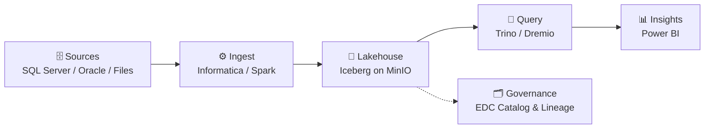

<!-- 
  HOW TO USE:
  1. Create a PUBLIC repo named exactly like your GitHub username (e.g. github.com/YOUR_USERNAME/YOUR_USERNAME)
  2. Paste this file as README.md
  3. Replace every YOUR_USERNAME, YOUR_EMAIL, YOUR_LINKEDIN with your own values
-->

<h1 align="center">👋 Hi, I'm Ali Sherif ☕🗄️⚙️📊🌊</h1>
<h3 align="center">Data Engineer · ETL Architect · Lakehouse Builder · Data Governance Enthusiast</h3>

  

---

### ☕ About Me

- ☕ Firm believer that coffee reduces pipeline latency and increases throughput (unbenchmarked, but trusted).
- 🛠️ Builds **ETL/ELT pipelines** that run at 3 AM so nobody else has to be awake.
- 🔍 Chases **incomplete lineage** in data catalogs like a detective chasing a missing suspect.
- 🌊 Spends free time spinning up **Docker lakehouses** — and then debugging why MinIO won't start.
- 🧪 Background in **computational chemistry** — so yes, I've converged both SCF cycles and DTM buffers.

---

### 🧭 My Philosophy of Data Life

> *"Garbage in, garbage out."* — every data engineer, ever.
>
> And the greatest joy is a green pipeline run, a reconciled row count, and a hot cup of coffee 😅☕💻

---

### 🔬 What I Actually Do (a.k.a. Areas of Work)

🏗️ **Enterprise ETL with Informatica PowerCenter**
Designing mappings, sessions & workflows — and tuning DTM buffers until throughput stops complaining.

🗂️ **Data Governance & Cataloging (Informatica EDC)**
Metadata scans, data domains, profiling, custom attributes, and connection assignment for end-to-end lineage.

🌊 **Open Lakehouse Architecture**
Apache Iceberg + Nessie + Spark + Trino + Dremio + MinIO + Flink — because one engine is never enough.

🔄 **Data Migration & Reconciliation**
SQL Server → Lakehouse migrations with SQL-only validation: counts, checksums, and "why is this row NULL?" investigations.

⚡ **SQL Server Performance Tuning**
Rewriting stored procedures to run faster with *identical* results (yes, I compared every row).

🧩 **Master Data Management**
Source → staging → golden record with AtroCore, fuzzy matching, and survivorship rules.

---

### 📂 Featured Projects (Real Pipelines, No Hype)

| Project | Description | Stack |
|---|---|---|
| 🌊 **[lakehouse-lab](https://github.com/YOUR_USERNAME/lakehouse-lab)** | Docker-based Iceberg lakehouse playground | Iceberg · Nessie · Spark · Trino · MinIO |
| 🔄 **[sqlserver-to-lakehouse](https://github.com/YOUR_USERNAME/sqlserver-to-lakehouse)** | End-to-end migration capstone with reconciliation & dashboards | SQL Server · Spark · Iceberg · Power BI |
| ✅ **[migration-validation-sql](https://github.com/YOUR_USERNAME/migration-validation-sql)** | SQL-only library of data reconciliation queries | T-SQL · Trino SQL |
| 🧱 **[adventureworks-dwh](https://github.com/YOUR_USERNAME/adventureworks-dwh)** | Star-schema DWH with product dimension (SCD) | SQL Server · Docker |
| 🔍 **[informatica-repo-queries](https://github.com/YOUR_USERNAME/informatica-repo-queries)** | PowerCenter repository metadata queries (mapping → session → source/target) | SQL Server · PowerCenter |

---

### 🔁 How I See a Pipeline

---

### 🛠️ Languages & Tools (a.k.a. Weapons of Choice)

💡 Mostly **SQL** and **Python**, occasionally **Bash**, always **Docker**.

  
  
  
  
  
  
  
  
  
  
  
  
  

---

### 📈 GitHub Activity (Yes, I Commit — Like a Transaction)

  
  

### 📊 Most Used Languages (Spoiler: SQL)

  

  

---

### 🌍 Find Me in the Wild

  
  

---

⭐ Thanks for visiting — feel free to explore, fork, or <code>MERGE INTO</code> responsibly.

